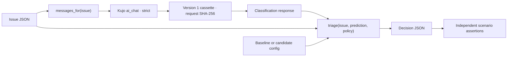

# Architecture

- [Model boundary](../src/model.kujo) builds two messages. The issue is serialized as data. The request uses a fixed model, endpoint, temperature and token cap. `ai_chat` matches its native request digest. Candidate policy is downstream of the AI call.
- [Decision layer](../src/triage.kujo) prioritizes active exposure and other security signals. Missing fields and invalid prediction data require manual intervention. Production impact and contradictions influence severity and routing, and a matching label reduces the confidence cutoff. The CLI can suggest actions and has no ticket-system write access.
- [Scorer](../experiments/scoring.kujo) compares each decision with a frozen oracle row. Every candidate executes the policy on newly replayed model responses. The only loaded caches are the runtime's cassette files. An unsuccessful replay records its native error and disqualifies the configuration.
- [Search](../experiments/runner.kujo) reads tuning data and creates a fresh output directory. It appends each result before advancing and emits a frozen winner after the last candidate. [Final validation](../experiments/final.kujo) checks the policy, source files and sealed held-out inputs, then runs a separate baseline/winner comparison.
- [Fixture provider](../tools/fixture_provider.kujo) serves an exact prompt lookup on loopback during explicit recording only. The response is OpenAI-shaped synthetic test data. Kujo controls cassette encoding, hashing and lookup.

The baseline policy is preserved in [source](../src/policy.kujo) and in [its configuration snapshot](../scenarios/baseline-policy.json). The [winning configuration](../results/winner-policy.json) runs against the same source. The lab CLI refuses a policy that disables active-exposure escalation. The experiment runner can execute that mutation to demonstrate the independent gate.
